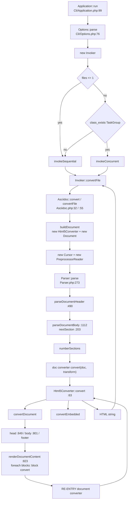
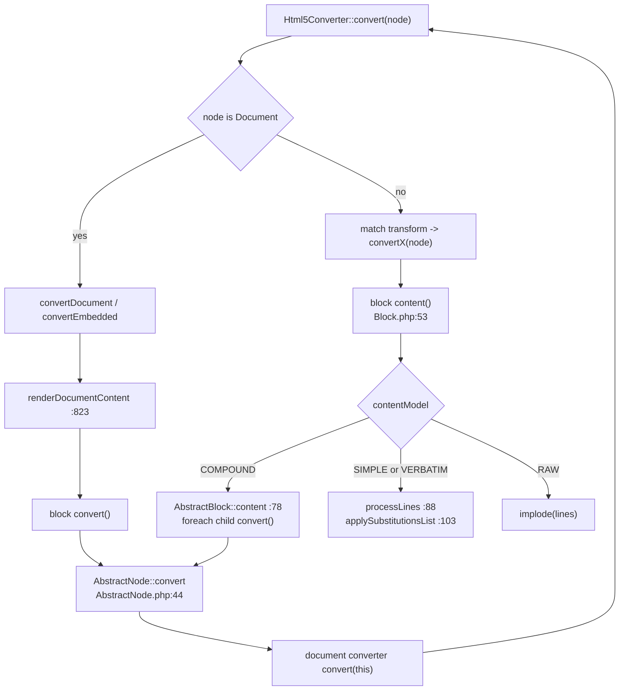

# 1.0.0 Execution Flow

Execution flow of a single `asciidoc-php` run, mapped from the code on the
`0.1.x` line.

Purpose: introspect the real flow before committing to a 2.0 architecture. These
diagrams describe what the code does today, not what it should do.

Line anchors refer to the tree at the time of writing.

---

## 1. Phase map

Plain-text rendering, for terminals and editors that do not render Mermaid.

```
CLI  Application::run                                   Cli/Application.php:99
  |
  +-> Options::parse                                    Cli/Options.php:76
  |     help / version / no-input-files short circuit
  |
  +-> new Invoker(options, logger, stderr)
  +-> Invoker::invoke
        |
        +-- files <= 1 -----------> invokeSequential
        +-- class_exists(Async\TaskGroup)
        |     +-- yes ------------> invokeConcurrent    concurrency limit
        |     +-- no -------------> invokeSequential
        |
        +-> Invoker::convertFile(input, outPath)        Cli/Invoker.php
              builds $opts: backend, doctype, safe, attributes,
                            header_footer, base_dir
              |
              +-> Asciidoc::convert(stream)  |  Asciidoc::convertFile(path)
                    |                           Asciidoc.php:32 / :55
                    |
                    +-> buildDocument($opts)            Asciidoc.php:92
                    |     new Html5Converter()          converter chosen here
                    |     new Document($opts)           backend stored, never read
                    |
                    +-> new Cursor + new PreprocessorReader
                    +-> Parser::parse(reader, document) Parser.php:273
                    |     parseDocumentHeader           Parser.php:490
                    |     parseDocumentBody             Parser.php:1112
                    |       nextSection, recursive      Parser.php:203
                    |     numberSections
                    |
                    +-> doc->getConverter()->convert(doc, transform)
                          transform = null | 'embedded'
                          |
                          +-> Html5Converter::convert   Html5Converter.php:63
```

## 2. Render dispatch

```
Html5Converter::convert(node, transform)                Html5Converter.php:63
  |
  +-- node is Document
  |     +-- transform is 'embedded' -> convertEmbedded
  |     +-- otherwise               -> convertDocument
  |                                      renderDocumentHead      :849
  |                                      renderDocumentBody      :801
  |                                        resolveTocPlacement   :1152
  |                                        renderSidebarToc
  |                                        renderDocumentHeader
  |                                        renderDocumentContent :823
  |                                        renderDocumentFooter
  |                                        renderHighlighterFoot
  |
  +-- any other node -> match(transform ?? node->getNodeName())
        'admonition' -> convertAdmonition     :140
        'paragraph'  -> convertParagraph
        ... roughly 50 dispatch targets in total
```

## 3. The recursion seam

```
renderDocumentContent
  foreach $doc->getBlocks() as $block
    $block->convert()                               AbstractNode.php:44
      document->getConverter()->convert($this)      back reference
        Html5Converter::convert($block)
          convertSection / convertAdmonition / ...
            $block->content()                       Block.php:53
              |
              +-- COMPOUND -> AbstractBlock::content AbstractBlock.php:78
              |                 foreach: $child->convert()   <-- back to step 1
              +-- SIMPLE   -> processLines(NORMAL_SUBS)      Block.php:88
              +-- VERBATIM -> processLines(VERBATIM_SUBS)
              +-- RAW      -> implode(lines)
              +-- EMPTY    -> ''
                                applySubstitutionsList  SubstitutorsTrait.php:103
```

## 4. End to end



## 5. The recursion seam



## 6. Phase reference

| Phase | Entry | Concern |
|---|---|---|
| CLI | `Application::run` | argument parsing, exit codes |
| Fan-out | `Invoker::invoke` | file enumeration, concurrency, diagnostics |
| Facade | `Asciidoc::convert` | document construction, reader and parser wiring |
| Parse | `Parser::parse` | header, section tree, block construction |
| Render | `Html5Converter::convert` | dispatch, layout, escaping, asset emission |
| Write | `Invoker::convertFile` | stdout or file |

## 7. Findings

### 7.1 One seam, not two

Two paths reach `Html5Converter::convert`:

1. Downward, from `renderDocumentContent` calling `$block->convert()`.
2. Upward, from `AbstractNode::convert()` asking the document for its converter.

The second exists only because a node holds a reference to the document. Remove
it and both collapse into a single downward walk. This is the smallest cut in
the flow, and it is a prerequisite for view helpers owning dispatch, because a
helper cannot be the router while the node still routes itself. It is also the
structural reason `SiteConverter` had to reimplement the block loop in order to
change two strings.

### 7.2 Substitution happens during render, not during parse

`Block::content()` runs the substitution pipeline every time it is called. The
tree is not fully processed after `Parser::parse()`. Any helper-based renderer
must call `content()` exactly as the converters do, and `content()` must not
become a partial's responsibility, or substitutions run once per partial render.
This is the most likely source of a silent output difference in a rewrite.

### 7.3 `$opts` never reaches the converter

`ConverterInterface::convert()` declares `array $opts = []`. `$opts` is consumed
by `Document` and dropped. No real call path passes it.

### 7.4 `backend` is inert

`backend` is stored on `Document`, threaded from `Invoker::convertFile` through
`Asciidoc` into `Document`, and read at no decision point. The dispatch in
`Html5Converter::convert` matches on `$transform`, which is only ever `null` or
`'embedded'`. `-b docbook5` is accepted and silently produces HTML5.

### 7.5 The CLI sits entirely above the library

`Invoker` touches only `Asciidoc::convert` and `Asciidoc::convertFile`. It knows
nothing about the AST. That is a single, clean cut with no rendering risk, which
is what makes wrapping the facade in a bus command safe.

## 8. Cut points against the 2.0 proposals

| Proposal | Cut point | Risk |
|---|---|---|
| Bus as execution substrate | wrap `Asciidoc::convert` | none to output; stable, well covered surface |
| Bus events for diagnostics | replace `quiet` / `verbose` / `timings` branches in the CLI | none |
| Laminas view renderer | `Html5Converter::convert` and everything below | the whole output surface |
| Remove the model back reference | `AbstractNode::convert` and `AbstractBlock::content` | bounded and mechanical, but inside the render recursion |
| Handler per presentation | the inert `backend` path | none; currently dead |

The flow supports the agreed order: bus first, renderer second. It also shows one
ordering constraint that is not negotiable: the model back reference must be
removed before or together with the renderer, never after. It lives inside the
recursion the renderer replaces, so deferring it means touching freshly rewritten
code.
